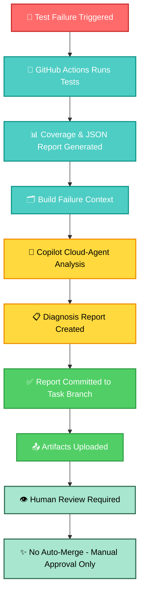
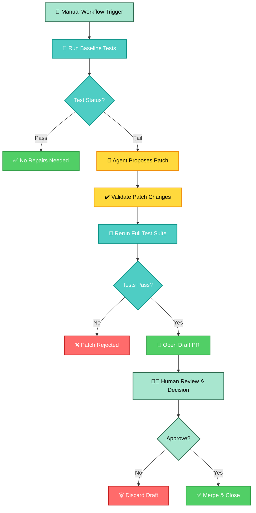

# Self-Healing CI - AI-Assisted Test Failure Diagnosis and Repair

> An intelligent GitHub Actions workflow powered by GitHub Copilot cloud-agent for automated test failure diagnosis, root-cause analysis, and repair proposal generation.

[](https://www.python.org/)
[](LICENSE)
[](https://github.com/AjiKunjumon/self-healing-ci)
[](https://github.com/features/actions)
[](https://github.com/features/copilot)
[](https://pytest.org/)
[](https://pytest-cov.readthedocs.io/)
[](https://github.com/AjiKunjumon/self-healing-ci)

## Overview

**Self-Healing CI** is a proof-of-concept portfolio project demonstrating how GitHub Copilot cloud-agent can automate the diagnosis of failing tests in CI/CD pipelines. This project showcases intelligent test failure analysis, root-cause detection, and AI-assisted repair proposals while maintaining human-in-the-loop validation.

### Key Features

- 🤖 **AI-Powered Diagnosis**: Automatic test failure analysis using GitHub Copilot cloud-agent
- 📊 **Coverage-Aware Mapping**: Links test failures to source code using pytest coverage reports
- 🔍 **Root-Cause Analysis**: Identifies affected Python source files and failure patterns
- 🚀 **Draft PR Generation**: Optional automated repair proposals with draft pull request creation
- 🛡️ **Human Review**: All agent-generated diagnostics and repairs require manual review
- 📝 **Rich Artifact Logs**: Detailed diagnosis reports and selected source context artifacts
- ⚡ **GitHub Native**: Integrates seamlessly with GitHub Actions and GitHub Copilot

## Workflow Architecture

### Diagnosis Workflow



**Workflow Steps:**
1. 📌 Test failure detected
2. 🔄 GitHub Actions runs test suite
3. 📊 Coverage reports and JSON generated
4. 🗂️ Failure context builder processes results
5. 🤖 Copilot cloud-agent analyzes failures
6. 📋 Diagnosis report created
7. ✅ Report committed to task branch
8. 📤 Artifacts uploaded to job
9. 👁️ Human review in job logs
10. ✨ No automatic merging - manual approval only

### Draft Repair PR Workflow



**Workflow Steps:**
1. 👤 Manually trigger repair workflow
2. 🧪 Run baseline tests
3. Test status check (pass/fail decision point)
4. ✅ If passing: no repairs needed
5. 🤖 If failing: agent proposes patch
6. ✔️ Validate patch file changes
7. 🧪 Rerun complete test suite with patch
8. Tests pass check (validation decision point)
9. ❌ If fails: patch rejected
10. 📝 If passes: open draft PR
11. 👨‍💻 Human review required
12. Approve check (merge decision point)
13. 🗑️ If rejected: discard draft
14. ✅ If approved: merge and close

## How It Works

### 1. Automated Test Failure Diagnosis

```
GitHub Actions Test Run → Failure Detection → Copilot Cloud-Agent Analysis → Diagnosis Report
```

**Step-by-step process:**

1. **Test Execution**: GitHub Actions runs your pytest test suite and generates JSON test reports
2. **Coverage Mapping**: Creates a context map linking each test to affected Python source files
3. **Agent Analysis**: Sends bounded failure logs and source context to Copilot cloud-agent for diagnosis
4. **Report Generation**: Agent commits structured diagnosis to task branch
5. **Result Display**: Concise diagnosis appears in job logs; full analysis available in artifacts

The workflow **does not apply code changes automatically** when baseline tests fail—it focuses on diagnosis only.

### 2. Optional Draft Repair PR

A separate manual workflow can generate and propose repairs:

1. Run **Self-healing CI - draft repair PR** workflow manually
2. Agent proposes a narrowly-scoped patch to `app.py`
3. Workflow validates the patch and reruns all tests
4. Opens a **draft PR** for human review—no automatic merging
5. Requires explicit approval before any code changes

## Setup & Configuration

### Prerequisites

- GitHub account with Copilot plan supporting cloud-agent tasks
- Python 3.8+
- Pytest with coverage and JSON report plugins

### Installation

1. **Clone the repository**:
   ```bash
   git clone https://github.com/AjiKunjumon/self-healing-ci.git
   cd self-healing-ci
   ```

2. **Create a fine-grained Personal Access Token**:
   - Go to [GitHub Settings → Developer Settings → Personal Access Tokens](https://github.com/settings/tokens?type=beta)
   - Create a new token with **Agent tasks: read and write** permission
   - Scope it to this repository

3. **Add token to repository secrets**:
   - Go to your repository → Settings → Secrets and Variables → Actions
   - Create a new secret named `COPILOT_AGENT_TOKEN`
   - Paste your personal access token

   > ⚠️ **Note**: The cloud-agent Tasks API does not accept the automatic `GITHUB_TOKEN`. A personal access token is required.

4. **Install dependencies**:
   ```bash
   python -m venv .venv
   source .venv/bin/activate  # On Windows: .venv\Scripts\activate
   python -m pip install -r requirements.txt
   ```

## Running the Demo

### Via GitHub Actions

1. Navigate to **Actions** → **Self-healing CI** workflow
2. Click **Run workflow**
3. Select `test/self-healing-failure` branch to see the diagnosis in action
4. Wait for the workflow to complete
5. Check the job log for the concise diagnosis
6. Download `ai-diagnosis` artifact for the full analysis

### Generate Draft Repair PR

1. Go to **Actions** → **Self-healing CI - draft repair PR**
2. Click **Run workflow** and select a branch
3. Enable `create_draft_pr` to propose repairs (default: enabled)
4. The workflow will:
   - Run baseline tests and diagnose failures
   - Generate a repair proposal
   - Rerun the full test suite
   - Open a draft PR for review

### Run Tests Locally

```bash
# Activate virtual environment
python -m venv .venv
source .venv/bin/activate

# Install dependencies
python -m pip install -r requirements.txt

# Run tests with coverage and generate reports
python -m pytest -q \
  --cov=. \
  --cov-context=test \
  --cov-report= \
  --json-report \
  --json-report-file=pytest-report.json

# Build failure context (requires COPILOT_AGENT_TOKEN for diagnosis)
python scripts/build_failure_context.py
```

## Project Structure

```
self-healing-ci/
├── .github/workflows/
│   ├── self-healing-ci.yml          # Main diagnosis workflow
│   └── self-healing-ci-draft-pr.yml # Repair proposal workflow
├── scripts/
│   └── build_failure_context.py     # Failure context builder
├── tests/
│   └── test_*.py                    # Test suite
├── app.py                            # Application code
├── requirements.txt                  # Python dependencies
└── README.md                          # This file
```

## Safety & Limitations

### Security Considerations
- ✅ Only Python files related to failed tests are included (with size limits)
- ✅ All generated diagnostics and repairs require human review
- ✅ No automatic code merging—draft PRs only
- ✅ Repository secrets are protected from fork pull requests

### Technical Limitations
- Coverage mapping identifies candidate files but cannot guarantee causality
- Import-based fallback for coverage is approximate
- Agent-generated diagnostics and repairs can be incorrect
- Agent confidence is a label, not a calibrated probability
- Patch proposals are limited to `app.py` with strict validation

### Requirements
- Requires Copilot plan supporting cloud-agent tasks
- Cloud-agent availability and performance are outside repository control
- Working branches created by agents should be reviewed and cleaned up manually

## Workflow Branches

| Branch | Purpose |
|--------|---------|
| `main` | Default branch with passing tests |
| `test/self-healing-failure` | Demo branch with intentional test failure |

Switch branches to see diagnosis in action on the failure branch.

## Troubleshooting

### Diagnosis Not Running
- Verify `COPILOT_AGENT_TOKEN` is set in repository secrets
- Check that your GitHub account has Copilot plan with cloud-agent access
- Ensure the token has "Agent tasks: read and write" permission

### Coverage Mapping Issues
- Verify pytest coverage plugins are installed: `pytest-cov`, `pytest-cov-context`
- Ensure coverage is enabled in pytest configuration
- Check that test files exercise the source code properly

### Repair PR Not Created
- Verify `create_draft_pr` input is enabled
- Check that the agent-proposed patch passes all tests
- Review the workflow log for validation errors

## Technologies & Tools

| Technology | Purpose |
|-----------|---------|
| **GitHub Actions** | CI/CD Workflow automation |
| **GitHub Copilot** | AI-assisted code analysis |
| **Python** | Application and test language |
| **pytest** | Testing framework |
| **pytest-cov** | Code coverage analysis |
| **pytest-json-report** | Structured test reporting |

## Contributing

This is a portfolio project demonstrating AI-assisted CI concepts. For feedback, issues, or improvement suggestions:

1. Open an **Issue** to report bugs or suggest features
2. Check existing discussions before opening new ones
3. For significant changes, open a draft PR for discussion
4. See [CONTRIBUTING.md](CONTRIBUTING.md) for detailed guidelines

## License

This project is licensed under the MIT License - see the [LICENSE](LICENSE) file for details.

## Learning Resources

For more on the technologies used:
- [GitHub Copilot Documentation](https://docs.github.com/en/copilot)
- [GitHub Actions Documentation](https://docs.github.com/en/actions)
- [pytest Documentation](https://docs.pytest.org/)
- [Code Coverage with pytest](https://pytest-cov.readthedocs.io/)
- [Mermaid Diagram Syntax](https://mermaid.js.org/)

## Author

[AjiKunjumon](https://github.com/AjiKunjumon) - Portfolio project exploring AI-assisted CI/CD workflows

---

**⭐ If this project interests you, please consider starring it!**

Questions? Feel free to open an issue or discussion.
